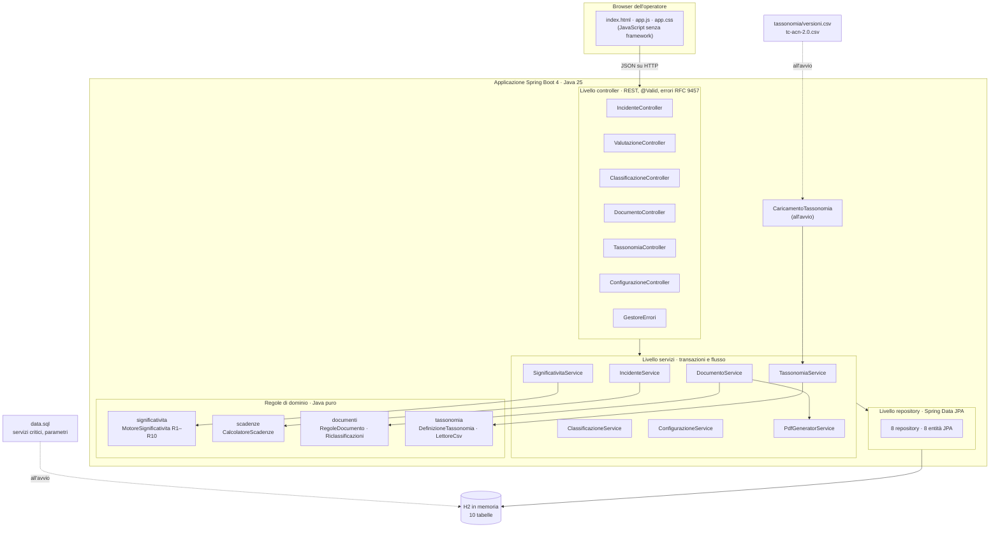

# Architettura

L'applicazione è un **monolite Spring Boot a livelli**: un unico JAR contiene interfaccia web, API REST,
logica applicativa e persistenza. Le regole di dominio (significatività, scadenze, matrice dei campi,
tassonomia) sono scritte in Java puro, senza dipendenze da Spring o dal database, e testate in isolamento.

## Diagramma dei componenti



Le dipendenze vanno solo verso il basso: i controller usano i servizi, i servizi usano regole di dominio e
repository. Le regole di dominio non conoscono né HTTP né il database.

## Livelli e responsabilità

| Livello | Package | Responsabilità | Non fa |
| --- | --- | --- | --- |
| Interfaccia | `static/` | Guida l'operatore; costruisce i moduli dalla matrice e dalla tassonomia ricevute dal backend | Non duplica regole, soglie o campi obbligatori |
| Controller | `controller`, `dto` | Traduce HTTP in chiamate ai servizi; valida il formato (`@Valid`); errori RFC 9457 (400, 404, 409, 422) | Nessuna logica di business |
| Servizi | `service` | Transazioni, ordine degli adempimenti, riuso dei dati, trasmissione, classificazione, PDF | Non conosce HTTP |
| Regole di dominio | `significativita`, `scadenze`, `documenti`, `tassonomia` | Regole R1–R10, calcolo dei termini, matrice dei campi, riclassificazioni successive alla notifica, validazione della tassonomia | Non accede al database |
| Modello | `model` | Entità JPA e invarianti: transizioni di stato, immutabilità dei documenti trasmessi, versioni delle classificazioni | |
| Persistenza | `repository` | Query derivate dal nome dei metodi; query SQL native di conteggio della tassonomia | |
| Configurazione | `config` | Orologio di sistema (`Clock`) e caricamento della tassonomia all'avvio | |

## Flusso principale

```mermaid
sequenceDiagram
    actor Op as Operatore
    participant UI as Interfaccia
    participant API as API REST
    participant Dom as Regole di dominio
    participant DB as Database

    Op->>UI: registra l'incidente
    UI->>API: POST /api/incidenti
    Op->>UI: indica gli impatti
    UI->>API: POST /api/incidenti/{id}/valutazioni
    API->>Dom: MotoreSignificativita (parametri v1)
    Dom-->>API: significativo, R7 [S1]
    API->>DB: stato SIGNIFICATIVO, momento di conoscenza
    Op->>UI: seleziona i valori TC-ACN
    UI->>API: POST /api/incidenti/{id}/classificazioni
    loop pre-notifica, notifica, relazione finale
        UI->>API: POST /api/incidenti/{id}/documenti (bozza precompilata)
        UI->>API: PUT /api/documenti/{id} (salvataggio in bozza)
        UI->>API: POST /api/documenti/{id}/trasmissione
        API->>Dom: ordine, campi mancanti (matrice)
        alt documento incompleto
            API-->>UI: 422 + campi mancanti
        else completo
            API->>DB: TRASMESSO, classificazione fissata, impronta SHA-256
        end
    end
    Op->>UI: riclassifica dopo la notifica (con motivazione)
    UI->>API: POST /api/incidenti/{id}/classificazioni
    API->>DB: classificazione v2; documenti trasmessi invariati
```

## Sicurezza del prototipo

| Aspetto | Stato | Motivazione |
| --- | --- | --- |
| Validazione dell'input | Lato server su ogni DTO (Bean Validation) e nelle regole dei servizi | Il client non è affidabile |
| Integrità dei documenti | Impronta SHA-256 calcolata alla trasmissione e verificabile (`integro`) | Dimostra che quanto inviato al CSIRT non è cambiato |
| Immutabilità | Metodi dell'entità e callback JPA `@PreUpdate`/`@PreRemove` | Doppio controllo sui documenti trasmessi |
| Interfaccia web | Testi inseriti nel DOM sempre come testo, mai come HTML | Protezione dal cross-site scripting (XSS) |
| Console H2 | Non inclusa | Evita l'esposizione del database in rete |
| CORS | Nessuna apertura | Interfaccia e API sono servite dalla stessa origine |
| Autenticazione e ruoli | Assenti | Fuori perimetro del prototipo: vedi i limiti del prototipo nel [README](../README.md) |

## Deploy

Il deploy con Docker e Render è descritto nella sezione "Deploy" del [README](../README.md).
