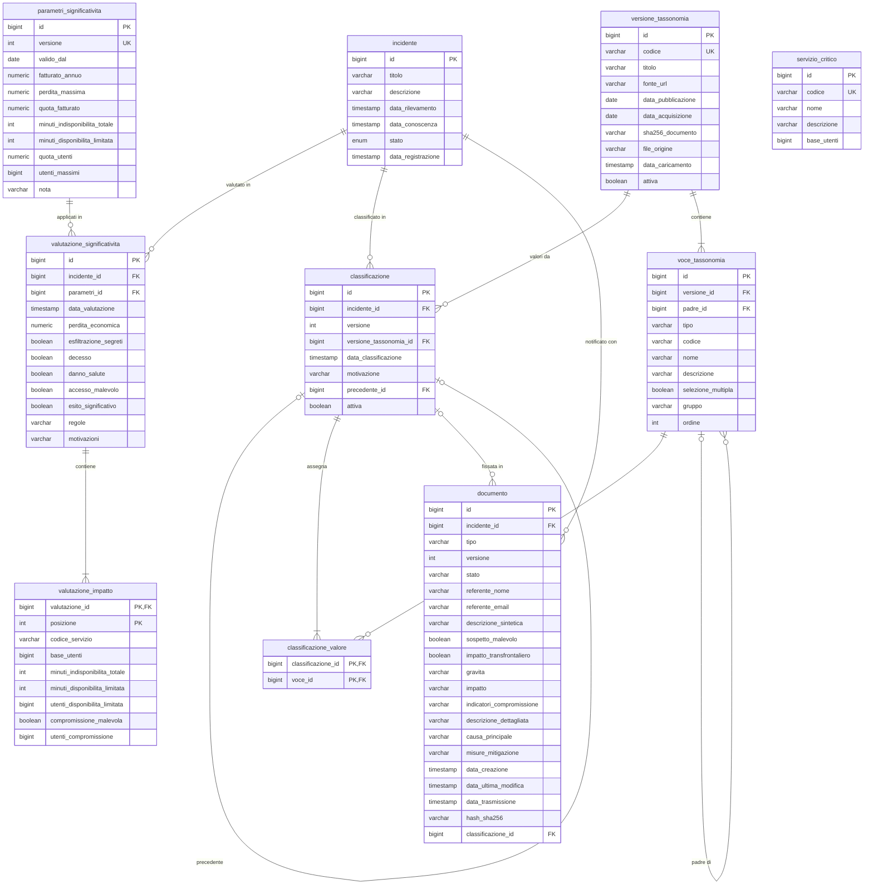

# Modello dati

Lo schema è generato da Hibernate a partire dalle entità JPA. Diagramma ER e data dictionary qui sotto sono
**verificati automaticamente** dal test `ModelloDatiDocumentatoTest`, che legge le tabelle e le colonne
effettive del database (`INFORMATION_SCHEMA`) e fallisce se questo documento non coincide. Lo stesso test
esporta il DDL reale in `target/schema.sql`, copiato in [`schema.sql`](schema.sql).

## Diagramma ER

`servizio_critico` non ha chiavi esterne verso altre tabelle: codice e base utenti del servizio sono
**copiati** in `valutazione_impatto` al momento della valutazione, perché la valutazione deve restare una
fotografia dei dati usati anche se in futuro la base utenti cambia.

## Vincoli principali

| Vincolo | Tabella | Significato |
| --- | --- | --- |
| `uk_documento_versione` (incidente_id, tipo, versione) | documento | Ogni adempimento ha versioni numerate senza duplicati |
| `uk_classificazione_versione` (incidente_id, versione) | classificazione | Versioni della classificazione numerate senza duplicati |
| `uk_voce_versione_codice` (versione_id, codice) | voce_tassonomia | Un codice TC-ACN compare una sola volta per versione |
| `codice` unico | servizio_critico, versione_tassonomia | Codici di riferimento univoci |
| `versione` unica | parametri_significativita | Una sola riga per versione dei parametri |

## Data dictionary

### `incidente`

Fascicolo dell'incidente.

| Colonna | Tipo | Vincoli | Descrizione |
| --- | --- | --- | --- |
| `id` | bigint identity | PK | Identificativo |
| `titolo` | varchar(200) | not null | Titolo sintetico |
| `descrizione` | varchar(4000) | | Descrizione libera |
| `data_rilevamento` | timestamp with time zone | not null | Momento del rilevamento, indicato dall'operatore |
| `data_conoscenza` | timestamp with time zone | | Momento in cui l'incidente è riconosciuto significativo: da qui decorrono 24 h e 72 h |
| `stato` | enum | not null | REGISTRATO, SIGNIFICATIVO, NON_SIGNIFICATIVO, CHIUSO |
| `data_registrazione` | timestamp with time zone | not null | Momento dell'inserimento nel sistema |

### `servizio_critico`

Servizi critici del contesto (dati di riferimento caricati da `data.sql`).

| Colonna | Tipo | Vincoli | Descrizione |
| --- | --- | --- | --- |
| `id` | bigint identity | PK | Identificativo |
| `codice` | varchar(10) | not null, unique | S1, S2, S3 |
| `nome` | varchar(200) | not null | Nome del servizio |
| `descrizione` | varchar(1000) | | Descrizione |
| `base_utenti` | bigint | not null | Utenti del servizio, base della soglia del 5% |

### `parametri_significativita`

Soglie versionate del Reg. (UE) 2024/2690 applicate al contesto.

| Colonna | Tipo | Vincoli | Descrizione |
| --- | --- | --- | --- |
| `id` | bigint identity | PK | Identificativo |
| `versione` | integer | not null, unique | Versione; è in vigore la più alta |
| `valido_dal` | date | not null | Data di validità |
| `fatturato_annuo` | numeric(15,2) | not null | Fatturato dell'ultimo esercizio chiuso |
| `perdita_massima` | numeric(15,2) | not null | Limite assoluto della perdita (500.000 €) |
| `quota_fatturato` | numeric(5,4) | not null | Quota del fatturato (0,05) |
| `minuti_indisponibilita_totale` | integer | not null | Soglia di indisponibilità totale (30) |
| `minuti_disponibilita_limitata` | integer | not null | Soglia di durata della disponibilità limitata (60) |
| `quota_utenti` | numeric(5,4) | not null | Quota degli utenti (0,05) |
| `utenti_massimi` | bigint | not null | Limite assoluto degli utenti (1.000.000) |
| `nota` | varchar(1000) | | Fonte e motivazione dei valori |

### `valutazione_significativita`

Ogni valutazione eseguita: dati in ingresso, versione dei parametri ed esito.

| Colonna | Tipo | Vincoli | Descrizione |
| --- | --- | --- | --- |
| `id` | bigint identity | PK | Identificativo |
| `incidente_id` | bigint | not null, FK | Incidente valutato |
| `parametri_id` | bigint | not null, FK | Versione dei parametri applicata |
| `data_valutazione` | timestamp with time zone | not null | Momento della valutazione |
| `perdita_economica` | numeric(15,2) | not null | Perdita stimata dichiarata |
| `esfiltrazione_segreti` | boolean | not null | Criterio art. 3.1.b |
| `decesso` | boolean | not null | Criterio art. 3.1.c |
| `danno_salute` | boolean | not null | Criterio art. 3.1.d |
| `accesso_malevolo` | boolean | not null | Criterio art. 3.1.e |
| `esito_significativo` | boolean | not null | Esito della valutazione |
| `regole` | varchar(100) | | Codici delle regole scattate (es. R7,R8) |
| `motivazioni` | varchar(4000) | | Una riga per regola, con riferimento e valori |

### `valutazione_impatto`

Impatti sui servizi critici al momento della valutazione (collezione incorporata nella valutazione).

| Colonna | Tipo | Vincoli | Descrizione |
| --- | --- | --- | --- |
| `valutazione_id` | bigint | PK, FK | Valutazione di appartenenza |
| `posizione` | integer | PK | Ordine dell'impatto nella valutazione |
| `codice_servizio` | varchar(10) | not null | Servizio impattato |
| `base_utenti` | bigint | not null | Base utenti copiata al momento della valutazione |
| `minuti_indisponibilita_totale` | integer | not null | Durata dell'indisponibilità totale |
| `minuti_disponibilita_limitata` | integer | not null | Durata della disponibilità limitata |
| `utenti_disponibilita_limitata` | bigint | not null | Utenti con disponibilità limitata |
| `compromissione_malevola` | boolean | not null | Compromissione da azione presumibilmente malevola |
| `utenti_compromissione` | bigint | not null | Utenti colpiti dalla compromissione |

### `versione_tassonomia`

Versioni della Tassonomia Cyber dell'ACN caricate nel sistema.

| Colonna | Tipo | Vincoli | Descrizione |
| --- | --- | --- | --- |
| `id` | bigint identity | PK | Identificativo |
| `codice` | varchar(50) | not null, unique | Codice della versione (es. TC-ACN-2.0) |
| `titolo` | varchar(300) | not null | Titolo del documento |
| `fonte_url` | varchar(500) | | URL del documento ufficiale |
| `data_pubblicazione` | date | | Data di pubblicazione |
| `data_acquisizione` | date | not null | Data di acquisizione del documento |
| `sha256_documento` | varchar(64) | | Impronta del PDF ufficiale |
| `file_origine` | varchar(200) | not null | File CSV da cui è stata caricata |
| `data_caricamento` | timestamp with time zone | not null | Momento del caricamento |
| `attiva` | boolean | not null | Versione usata per le nuove classificazioni |

### `voce_tassonomia`

Voci della tassonomia (macrocategorie, predicati, valori), organizzate ad albero.

| Colonna | Tipo | Vincoli | Descrizione |
| --- | --- | --- | --- |
| `id` | bigint identity | PK | Identificativo |
| `versione_id` | bigint | not null, FK | Versione di appartenenza |
| `padre_id` | bigint | FK | Voce di livello superiore (null per le macrocategorie) |
| `tipo` | varchar(20) | not null | MACROCATEGORIA, PREDICATO, VALORE |
| `codice` | varchar(40) | not null | Codice ufficiale (es. BC:IM_AV), unico nella versione |
| `nome` | varchar(200) | not null | Nome ufficiale (in inglese) |
| `descrizione` | varchar(2000) | | Descrizione dal documento ufficiale |
| `selezione_multipla` | boolean | not null | Per i predicati: ammette più valori per incidente |
| `gruppo` | varchar(100) | | Sotto-predicato di raggruppamento (solo Involved Asset) |
| `ordine` | integer | not null | Ordine del documento ufficiale |

### `classificazione`

Versioni della classificazione TC-ACN di un incidente.

| Colonna | Tipo | Vincoli | Descrizione |
| --- | --- | --- | --- |
| `id` | bigint identity | PK | Identificativo |
| `incidente_id` | bigint | not null, FK | Incidente classificato |
| `versione` | integer | not null | Versione della classificazione, unica con l'incidente |
| `versione_tassonomia_id` | bigint | not null, FK | Versione della TC-ACN da cui provengono i valori |
| `data_classificazione` | timestamp with time zone | not null | Momento della classificazione o riclassificazione |
| `motivazione` | varchar(2000) | | Motivazione del cambiamento (obbligatoria dalla versione 2) |
| `precedente_id` | bigint | FK | Versione precedente (null per la versione 1) |
| `attiva` | boolean | not null | Vero solo per l'ultima versione |

### `classificazione_valore`

Valori della tassonomia assegnati a ciascuna versione della classificazione.

| Colonna | Tipo | Vincoli | Descrizione |
| --- | --- | --- | --- |
| `classificazione_id` | bigint | PK, FK | Versione della classificazione |
| `voce_id` | bigint | PK, FK | Valore della TC-ACN assegnato |

### `documento`

Adempimenti verso il CSIRT (pre-notifica, notifica, relazione finale), versionati; il contenuto è
incorporato nella stessa tabella.

| Colonna | Tipo | Vincoli | Descrizione |
| --- | --- | --- | --- |
| `id` | bigint identity | PK | Identificativo |
| `incidente_id` | bigint | not null, FK | Incidente a cui si riferisce |
| `tipo` | varchar(30) | not null | PRE_NOTIFICA, NOTIFICA, RELAZIONE_FINALE |
| `versione` | integer | not null | Versione per quel tipo, unica con incidente e tipo |
| `stato` | varchar(20) | not null | BOZZA o TRASMESSO |
| `referente_nome` | varchar(200) | | Punto di contatto – nome |
| `referente_email` | varchar(200) | | Punto di contatto – e-mail |
| `descrizione_sintetica` | varchar(2000) | | Descrizione sintetica |
| `sospetto_malevolo` | boolean | | Sospetto di atto illegittimo o malevolo (null = non indicato) |
| `impatto_transfrontaliero` | boolean | | Impatto transfrontaliero (null = non indicato) |
| `gravita` | varchar(20) | | BASSA, MEDIA, ALTA, CRITICA |
| `impatto` | varchar(4000) | | Descrizione dell'impatto |
| `indicatori_compromissione` | varchar(4000) | | Indicatori di compromissione, ove disponibili |
| `descrizione_dettagliata` | varchar(8000) | | Descrizione dettagliata (relazione finale) |
| `causa_principale` | varchar(4000) | | Tipo di minaccia o causa principale |
| `misure_mitigazione` | varchar(4000) | | Misure di attenuazione applicate e in corso |
| `data_creazione` | timestamp with time zone | not null | Creazione della bozza |
| `data_ultima_modifica` | timestamp with time zone | not null | Ultimo salvataggio |
| `data_trasmissione` | timestamp with time zone | | Momento della trasmissione (null in bozza) |
| `hash_sha256` | varchar(64) | | Impronta del testo canonico calcolata alla trasmissione |
| `classificazione_id` | bigint | FK | Classificazione in vigore alla trasmissione (null in bozza) |
