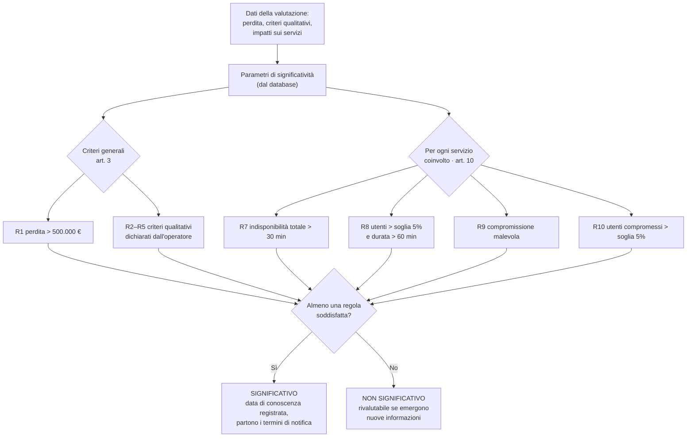

# Regole di significatività R1–R10

Le regole traducono i criteri del Regolamento di esecuzione (UE) 2024/2690 in condizioni che il software applica
a ogni valutazione. Sono implementate in `MotoreSignificativita` (package `significativita`) e verificate da
`MotoreSignificativitaTest`, con valori appena sopra e appena sotto ogni soglia.

## Principi

- **Basta una regola.** L'incidente è significativo se è soddisfatta almeno una regola; l'esito elenca tutte le
  regole scattate, ciascuna con il riferimento all'articolo e i valori che l'hanno attivata.
- **Confronto stretto.** Il Regolamento usa sempre la formula "più di": un valore esattamente pari alla soglia non
  rende l'incidente significativo.
  - **Soglie come dati.** Fatturato, quote e durate sono salvati nella tabella `parametri_significativita` (caricata
    da `data.sql`) e non scritti nel codice: per aggiornarli basta modificare il dato.
- **Criteri generali e per servizio.** R1–R5 si valutano una volta per incidente; R7–R10 si valutano per ciascun
  servizio critico coinvolto, con la soglia utenti di quel servizio.

## Tabella delle regole

| Regola | Riferimento | Condizione | Soglia per Alfa Managed Services | Tipo |
| --- | --- | --- | --- | --- |
| R1 | art. 3.1.a | Perdita economica > minore tra 500.000 € e 5% del fatturato | > 500.000 € | Quantitativa |
| R2 | art. 3.1.b | Esfiltrazione di segreti commerciali | Sì / No | Dichiarata dall'operatore |
| R3 | art. 3.1.c | Decesso di una persona fisica | Sì / No | Dichiarata dall'operatore |
| R4 | art. 3.1.d | Danno considerevole alla salute di una persona fisica | Sì / No | Dichiarata dall'operatore |
| R5 | art. 3.1.e | Accesso non autorizzato presumibilmente malevolo, con possibile grave perturbazione | Sì / No | Dichiarata dall'operatore |
| R6 | art. 4 | Incidenti ricorrenti | — | Non implementata (richiede uno storico) |
| R7 | art. 10.a | Indisponibilità totale del servizio > 30 minuti | > 30 min | Quantitativa, per servizio |
| R8 | art. 10.b | Disponibilità limitata per > 5% degli utenti **e** per > 60 minuti | S1 > 600, S2 > 400, S3 > 250 utenti; > 60 min | Quantitativa, per servizio |
| R9 | art. 10.c | Dati o servizi compromessi da un'azione presumibilmente malevola | Sì / No | Dichiarata dall'operatore, per servizio |
| R10 | art. 10.d | Compromissione che interessa > 5% degli utenti del servizio | S1 > 600, S2 > 400, S3 > 250 utenti | Quantitativa, per servizio |

**Calcolo delle soglie.** La soglia di perdita è il minore tra 500.000 € e il 5% del fatturato (24 M€ × 5% =
1,2 M€), quindi 500.000 €. La soglia utenti è il minore tra il 5% della base utenti del servizio e 1.000.000,
arrotondato per difetto perché gli utenti sono numeri interi.

## Flusso di valutazione

## Esempi

| Caso | Regole scattate | Esito |
| --- | --- | --- |
| S1 indisponibile per 31 minuti | R7 (31 min > 30 min) | Significativo |
| S1 indisponibile per 30 minuti | nessuna (30 non è > 30) | Non significativo |
| S2 con disponibilità limitata per 600 utenti per 90 minuti | R8 (600 > 400 e 90 > 60) | Significativo |
| S2 con disponibilità limitata per 600 utenti per 60 minuti | nessuna (60 non è > 60) | Non significativo |
| Perdita economica di 500.000,01 € | R1 | Significativo |
| Perdita economica di 500.000 € | nessuna | Non significativo |
